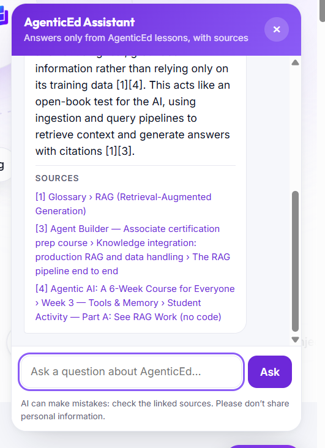
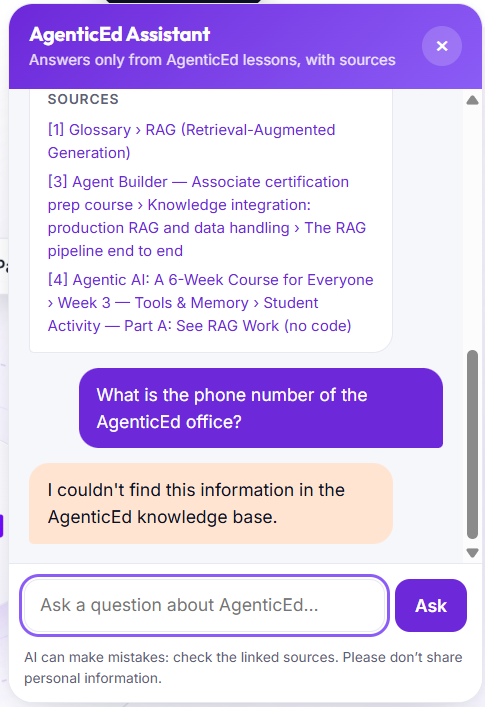

# AgenticEd Learning Assistant (RAG chatbot)

A chatbot that answers questions about AgenticEd **only from AgenticEd's own content**
(course pages, FAQ, glossary, curriculum and certification prep courses), shows the
**sources** it used, and says *"I couldn't find this information in the AgenticEd knowledge
base."* when the answer isn't there, instead of guessing.

It uses the same building blocks as the Week 3 lab (`labs/week3_tools_rag_memory.ipynb`):
sentence-transformers embeddings, a ChromaDB vector database, BM25 + Reciprocal Rank Fusion
hybrid search, and cited answers with abstention.



## How it works

```
AgenticEd website files (HTML, Markdown, certification course data)
        │  build_knowledge.py: split by heading, keep file + URL + section
        ▼
knowledge/agenticed_knowledge.jsonl         511 chunks from 29 sources
        │  rag.py: embed with all-MiniLM-L6-v2 (runs locally, free)
        ▼
ChromaDB vector database (chroma_db/)        rebuilt automatically when the knowledge changes
        │
Student question ──► hybrid search: dense (ChromaDB) + keyword (BM25), merged with RRF ──► top 4 chunks
        │
        ├─ Guard: best similarity < 0.30?  ──► "I couldn't find this…" (LLM not called)
        ▼
LLM (Gemini via OpenAI-compatible API): "answer ONLY from these sources, cite [n]"
        │
        ├─ LLM says not found, or cites no source? ──► "I couldn't find this…"
        ▼
Answer + [n] citations + source links       (server.py ──► chatbot/widget on the website)
```

**Two layers stop invented answers:**
1. **Similarity guard:** off-topic questions never reach the LLM.
   *"What is the weather in Mumbai today?"* scored 0.184 and was refused.
2. **Grounded prompt + citation check:** for on-topic questions the site doesn't answer, the
   LLM must refuse, and any answer without a valid `[n]` citation is replaced by the refusal.
   *"When will the Level 2 path launch?"* scored 0.616, but the site has no date, so it was refused.

**What is deliberately excluded from the knowledge base:** the certification **exam question
bank** (`certifications/cert-data.js` questions) and knowledge-check answers, so the assistant
can't leak exam answers. A check confirmed 0 of the 60 exam questions are in the knowledge file.

## Files

| File | Purpose |
|---|---|
| `build_knowledge.py` | Reads the website content and writes the knowledge file |
| `knowledge/agenticed_knowledge.jsonl` | **The AgenticEd knowledge file** (one chunk per line: `id, source, url, title, section, text`) |
| `rag.py` | RAG engine: embeddings, ChromaDB, hybrid search, guard, LLM answer, citations. Also a command-line chat |
| `server.py` | Flask API (`/api/health`, `/api/chat`) + local preview of the website |
| `widget/chatbot.js`, `widget/chatbot.css` | The "✦ Ask AgenticEd" chat widget for the website |
| `eval/questions.jsonl` | 5 answerable + 2 missing-information questions |
| `run_eval.py` | Runs the 7 questions and saves `eval/results.md` |
| `tests/test_no_invented_answers.py` | Tests proving the chatbot doesn't invent answers |
| `INTEGRATION_PLAN.md` | How to take this to the live website |
| `.env.example` | Template for your API key and settings |

## Setup (Windows, Python 3.11 to 3.13)

```bat
cd AgenticEd\chatbot
python -m venv .venv
.venv\Scripts\activate
pip install -r requirements.txt
copy .env.example .env
```
Open `.env` and add a key. A free Gemini key works: <https://aistudio.google.com/apikey>.
On macOS/Linux use `source .venv/bin/activate` and `cp` instead of `copy`.

The first run downloads the embedding model (~90 MB) and builds `chroma_db/` (about a minute).

## Use it

```bat
:: Ask one question in the terminal
python rag.py "Do I need coding experience to learn AgenticEd?"

:: Interactive chat in the terminal
python rag.py

:: Website + chat widget: then open http://127.0.0.1:5000
python server.py

:: Rebuild the knowledge file after website content changes
python build_knowledge.py
```

Without an API key the bot still works in **retrieval-only mode**: it shows the best
matching AgenticEd passage and its source instead of a generated answer.

## Evaluation and tests

```bat
python run_eval.py          :: 7 questions -> eval/results.md
python -m pytest -v         :: 6 tests (3 offline with a fake LLM, 3 with the real LLM)
```

### Results (7 Nov 2026, `gemini-3.6-flash`)

**`run_eval.py`: 7/7 passed**: full answers and sources are in [`eval/results.md`](eval/results.md).

| # | Question | Expected | Result | Best similarity |
|---|---|---|---|---|
| a1 | Is AgenticEd free to use? | answer | ✅ "Yes, AgenticEd is free to use [1][2]…" (README) | 0.675 |
| a2 | Do I need coding experience to learn AgenticEd? | answer | ✅ "No, you do not need any prior coding experience…" (homepage, curriculum) | 0.666 |
| a3 | How many questions are in the AI & Agent Foundations exam, and what score passes? | answer | ✅ "20 questions… 14 of 20 correct, 70%" (certifications) | 0.746 |
| a4 | What is RAG (Retrieval-Augmented Generation)? | answer | ✅ cited glossary, Foundations course, Week 3 | 0.755 |
| a5 | What do students build in Week 5? | answer | ✅ "build their own AI agent… one-page agent policy" (curriculum) | 0.573 |
| m1 | When will the Level 2 AI Application & Agent Builder path launch? | refuse | ✅ "I couldn't find this information…" | 0.616 |
| m2 | What is the phone number of the AgenticEd office? | refuse | ✅ "I couldn't find this information…" | 0.467 |

**`pytest`: 6 passed**

| Test | Proves |
|---|---|
| `test_off_topic_question_is_refused_before_the_llm_is_called` | Off-topic questions are refused and the (fake) LLM is never called |
| `test_answer_without_citations_is_blocked` | A fake LLM that invents a price ("Rs 999 per month") without citing a source is blocked |
| `test_llm_refusal_is_passed_through_without_sources` | Refusals reach the student with no fake sources |
| `test_real_llm_refuses_missing_information` ×2 | Real Gemini refuses m1 and m2, with no dates or phone numbers |
| `test_real_llm_answers_supported_question_with_sources` | Real Gemini answers a supported question with `[n]` citations |

The **similarity cut-off of 0.30** was chosen from measured scores: on-topic questions scored
0.45–0.76 and the off-topic weather question 0.184.

### Screenshots

| Answer with sources | Missing information refused |
|---|---|
|  |  |

## Settings (`.env`)

| Variable | Default | Meaning |
|---|---|---|
| `GEMINI_API_KEY` / `OPENAI_API_KEY` / `ANTHROPIC_API_KEY` | none | One LLM key (all called through the `openai` package) |
| `AGENTICED_MODEL` | `gemini:gemini-3.8-flash` | Main model, as `provider:model` |
| `AGENTICED_FALLBACK_MODEL` | `gemini-3.6-flash` | Used when the main model is overloaded |
| `AGENTICED_MIN_SIMILARITY` | `0.30` | Guard threshold |
| `AGENTICED_RATE_LIMIT` | `10` | Questions per minute per visitor |
| `AGENTICED_ALLOWED_ORIGINS` | `https://agenticed.org,https://www.agenticed.org` | Sites allowed to call the API |

## Known limitations

- **Free-tier Gemini is often busy** (HTTP 503/429). `rag.py` waits and retries (3s, 8s, 15s),
  then switches to the fallback model; during testing `gemini-3.8-flash` was busy for most
  requests, so `gemini-3.6-flash` is the recommended main model. Answers take 5–30 s.
- On the free tier Google may use prompts to improve its models; see the integration plan
  for production.
- The knowledge file must be rebuilt (`python build_knowledge.py`) when site content changes.
- Pages that render content only with JavaScript (quiz, exam, dashboard) are not indexed.
- The README's "Repository Structure" section is out of date, so it is skipped during ingestion.
